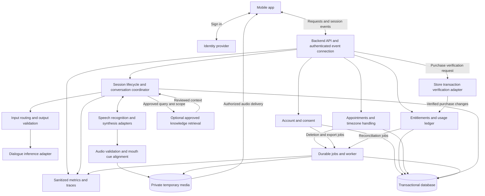
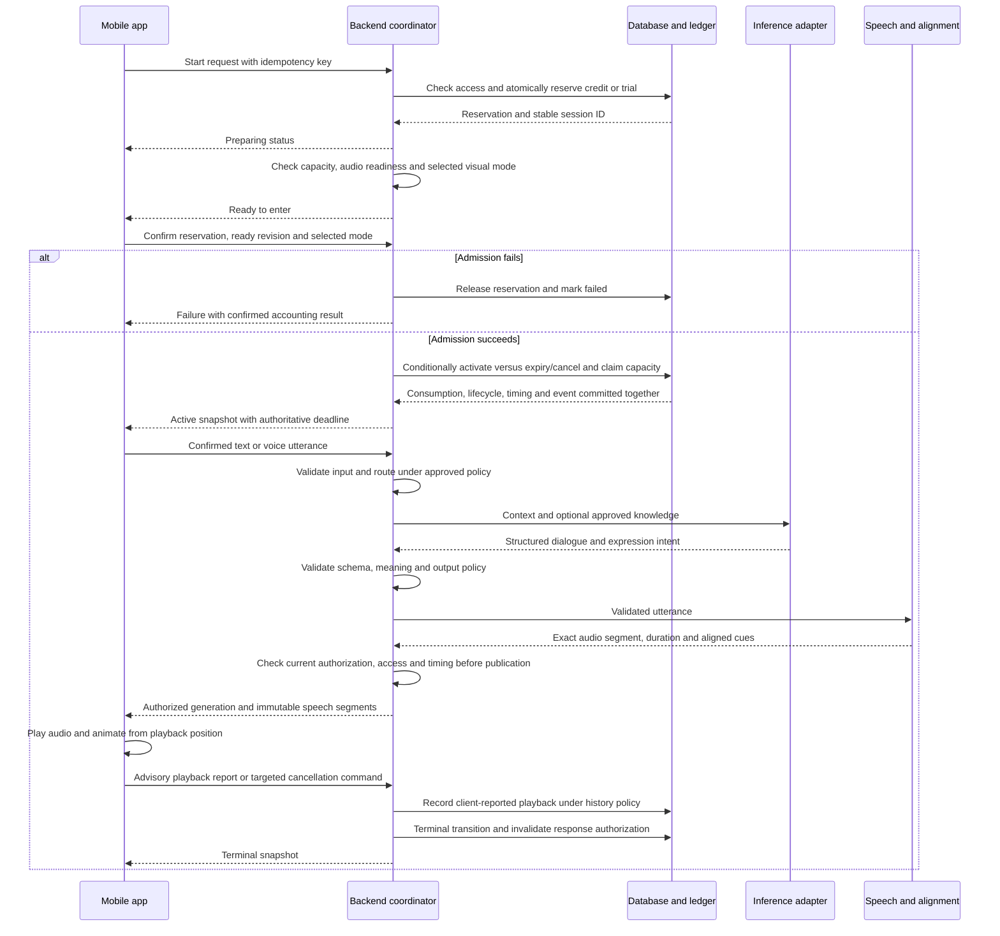

# Approved implementation stack

October13 user decision: TypeScript, Node24, Fastify, PostgreSQL and WebSocket. Latest steering enables Docker/Compose, superseding the earlier exclusion. The standalone repository is EdKo2001/mind-space-backend. Provider endpoints remain deferred. See README.md and CURRENT_ACCEPTANCE_LEDGER.md for implemented versus proposed boundaries.

The workflow below preserves the reviewed architecture. References to the mobile app and product policies are historical source pointers; they are not local files in this standalone checkout. Stack approval does not approve pending product/retention/billing policies.

# MindSpace backend architecture workflow

Draft architecture · Revised October 13, 2026

Implementation checkpoint: the user subsequently authorized local work and a backend matching the operations dashboard. The [session foundation](README.md) now includes HTTP/WS transport, durable PostgreSQL metadata/ledger/outbox, expiry maintenance, [live state publication/recovery](docs/session-channel.md) and the local aggregate [dashboard contract](docs/dashboard-api.md). Identity, provider/media delivery, production admin access and mobile integration remain unconnected; production policies are not selected by the test profile. The design below includes future workflows as well as that bounded implementation.

The backend will own authenticated access, session lifecycle, usage accounting and AI/voice orchestration. The mobile app will own presentation, audio playback and avatar rendering. This workflow proposes those boundaries without selecting providers, provisioning infrastructure or changing the current local demo.

## System workflow

Start with one backend application containing clear domain modules and a separate worker process for slow jobs. Inference and speech run behind replaceable adapters; they can be hosted services or separate compute processes. Splitting every domain into a microservice is unnecessary at this stage.

The identity token is verified at the backend. Every request, event connection and media fetch checks ownership. Provider credentials remain on the backend. Account access, balances and session deadlines never come from model output or client assertions.

## Ownership

| Component | Responsibility |
| --- | --- |
| Mobile app | Input UI, microphone consent/capture when implemented, playback position, optional avatar, connection feedback and countdown display. |
| Account module | Account identity mapping, preferred IANA timezone, consent versions, history preferences and deletion requests. |
| Access module | Verified subscription access, finite or unlimited message allowance, session credits, atomic reservations and immutable ledger entries. |
| Appointment module | Book, reschedule and cancel appointments; validate local times and preserve resolved UTC instants. |
| Session coordinator | Admission, authoritative start/end time, response cancellation, reconnect snapshots and terminal states. |
| Conversation module | Confirmed inputs, bounded context, optional retrieval, structured responses and reviewed safety routing. |
| Voice adapters | Speech recognition, synthesis and media alignment; expose actual capabilities and failures. |
| Worker | Reminders, subscription reconciliation, allowance refills, exports, deletion and temporary-media cleanup. |
| Monitoring | Operational counts, timings and failure codes. Product analytics receives only an approved event allowlist. |

## Account and access workflow

1. Sign in through the selected identity system; backend verifies identity and resolves the account.
2. Record required consent before sending conversation or voice content to a provider. Saved history remains an explicit product decision; the proposed default in `PRODUCT_POLICY_DRAFT.md` is off.
3. Accept the phone's detected IANA timezone at setup, falling back to `America/Chicago`; preserve manual overrides.
4. Return verified access and usage as finite, unlimited or unavailable. Missing data must not appear as zero.
5. Authorize each conversation, appointment, session and media object against the account. Rate limits and capacity checks apply independently of paid allowances, including unlimited plans.

## Live session workflow

The paid duration is fixed at 45 minutes; the separate trial is 10 minutes. Admission accounting below follows the provisional policy draft. The proposed admission rules below are concrete design inputs, not approved billing policy. Disconnect, pause and outage rules still require agreement before paid implementation.

- Start retries return the same admission result. Competing starts cannot spend the same last credit or trial; admission reservations need bounded expiry and crash recovery.
- Proposed lifecycle: `preparing → active → ended`, with `preparing → failed/canceled`. Connection status is separate from lifecycle. Reconnect returns the same session and deadline; it does not spend another credit.
- The backend enforces persisted timing according to the selected policy even while the app is closed. The diagram illustrates an absolute deadline; it does not approve whether disconnect or pause consumes paid time. Permitted timing changes are server-authorized, persisted and revisioned. Under an absolute deadline, handlers check expiry before accepting input or publishing media, and snapshots reconcile elapsed sessions to terminal state; timer jobs are not the sole check. The client stops scheduled playback at the valid communicated deadline and reconciles on resume. Unavailable timing grants no extension and displays an unavailable clock. Threshold notices belong to the app and remain scoped to the same session. Paid sessions cross 15, 10 and 1 minute; the 10-minute trial excludes the 15-minute threshold and must not show a crossing notice merely because it starts at 10 minutes. Trial start information is separate from remaining-time warnings.
- Hiding the avatar preserves audio and lifecycle. Renderer failure leaves controls usable. Visible mode can wait for required visual readiness; hidden mode never requires 3D loading.
- Interruptions cancel the active response and audio preparation, invalidate its IDs and reject late events. Retry and fallback behavior must be bounded and cannot manufacture successful delivery.
- Conversation progress distinguishes generated, delivered to client, client-reported playback position, interrupted and unknown. Playback acknowledgements describe device playback, not whether the person listened. Missing acknowledgements remain unknown. They may guide conversation context but cannot alone authorize refunds, deadline extensions or credits.

## Proposed admission policy

| Situation | Proposed behavior for review |
| --- | --- |
| Start request | Reserve access in a short transaction; keep the session preparing with no paid start instant. |
| Required audio readiness | Check microphone permission when voice input is required, usable input/output transport, provider capacity and playback readiness. A text-input test can explicitly omit microphone capture. |
| Visible avatar readiness | Wait for the selected visual mode. If rendering fails, offer an explicit audio-only choice; do not silently change mode. Hidden mode requires no renderer. |
| Ready and user confirms entry | Recheck reservation ownership, expiry, readiness and access; atomically consume once and persist server start/end instants plus activation event. Only this commit starts paid time. |
| Preparation failure, timeout or cancellation | Release once. A failed or expired reservation cannot activate from a delayed confirmation. |
| Lost activation reply | Retry or fetch snapshot by the same admission identity; return the committed session rather than reserving again. |
| Disconnect after activation | Preserve the session and prohibit another charge. Whether time continues, any reconnect grace and termination rules remain pending policy. |
| Provider outage after activation | Return a recovery state; bounded retries and an approved compensation/support policy are required before paid release. |

No database transaction spans a provider call or client readiness wait. Reservation, activation and preparation cancellation/expiry use short transactions against the same durable admission state. Activation and release are mutually exclusive: activation requires an owned, unexpired preparing reservation and atomically records consumption, active lifecycle, server timing and the activation event. Cancellation or expiry releases only an unconsumed preparing reservation.

Under the proposed confirmation policy, confirmation identifies the reservation, ready snapshot's `sessionRevision` and selected input/visual mode. Reject obsolete confirmations rather than activating a different or expired offer. Client readiness is a freshness-bound observation, not proof of audible output or future provider availability. Claim locally limited admission capacity atomically; external health/capacity checks remain observations. Preparation and readiness expiry values must be chosen before testing.

If activation wins, preparation cancellation returns `already_active` with the current snapshot; it cannot release consumed access. Ending or compensating that session is a separate policy-governed operation. If cancellation/expiry wins, delayed confirmation cannot activate. Handlers and recovery use the same conditional state checks, including expiry checks independent of delayed cleanup jobs.

## Live turn management

The session coordinator owns committed turns. A turn-management adapter combines speech activity, transcript/semantic endpoint signals and explicit user actions; voice activity alone is insufficient. Detection thresholds and language support require measured validation.

| Input situation | Required behavior |
| --- | --- |
| Pause within an unfinished thought | Continue collecting the utterance under bounded endpointing rules; do not commit every silence as a new turn. |
| Complete thought | Commit one stable utterance ID and immutable transcript revision; emit a correlated turn-committed marker. |
| Genuine interruption | Stop local playback promptly, invalidate queued segments immediately and send a cancellation command. Server cancellation invalidates inference, synthesis and alignment results for that generation. |
| “Mm-hmm” or “right” during assistant speech | Distinguish acknowledgement from a request to take the turn; do not cancel solely on detected speech. Ambiguous behavior needs explicit test cases. |
| Speaker output captured by microphone | Use the selected audio path's echo handling and output-aware detection; do not submit assistant audio as a fresh user utterance. Test speaker and headphone modes. |
| Explicit stop | Stop locally without waiting for a network round trip, then reconcile server cancellation. |

These requirements are provider-independent. [LiveKit's turn-management documentation](https://docs.livekit.io/agents/logic/turns/) separates endpointing and interruption detection, including conversational acknowledgements; it is a reference, not a provider choice.

## AI and voice turn workflow

`Confirmed input → input routing → bounded context → optional approved retrieval → structured model response → schema and output checks → text delivery or synthesis → exact audio alignment → authenticated events → playback-driven avatar`

Two voice milestones share the same coordinator and playback contract:

- **First connected version:** validate the whole short response, prepare the first complete audio phrase with aligned cues, then play it. Instrument all stages immediately and measure this baseline before optimizing.
- **Production voice version:** streaming recognition, deliberate turn detection, short validated speech units, overlapping later audio preparation and cancellation throughout. Add streaming decode/buffering only where measurements justify it. Every unit must pass output policy checks before synthesis or playback; partial text must not bypass validation.

Retrieval is coordinator-controlled: the backend decides whether to retrieve, enforces the approved collection/account scope and supplies results to inference. Model-directed retrieval is not part of the initial contract.

The model supplies words and restrained expression intent. The backend supplies session/response IDs, event sequences, audio references, measured durations and timed cues. Model output cannot set credits, URLs, deadlines or morph coefficients. Unmapped animation intent stays unavailable.

Reuse `src/features/session/mock-therapist/contract.ts` and its coordinator through a feature-owned connected transport. Extend and version the contract for session snapshots, typed errors, delivery acknowledgements and reconnect recovery; the current local contract alone is not a complete production protocol. Events retain `eventId`, `sessionId`, sequence and matching `responseId`/speech IDs. Reconnect must distinguish recoverable gaps from a required fresh snapshot and must not replay already heard speech automatically.

Audio cue times refer to the exact final audio segment, including silence. The app advances cues using playback position; pauses and buffering freeze them. Validate duration, cue bounds, segment order and media ownership before delivery. Synthesis speed settings alone do not establish measured speech pacing.

Retrieval and model training remain optional research. A future offline route is `permission-reviewed sources → curated knowledge/examples → independent evaluation → versioned candidate → release gate → rollback-capable deployment`. Private customer conversations do not enter this route automatically. No model, voice, training stack or GPU is selected by this workflow.

## Proposed voice acceptance targets

These are proposed targets from the review, not measured results or release promises. Evaluate ordinary turns separately from deliberately longer thinking pauses, network failures and safety routing; disclose exclusions and test conditions.

| Measurement | Proposed acceptance target |
| --- | --- |
| Clear user turn end to first meaningful audible reply | Median ≤1.2 seconds; P95 ≤2 seconds across ordinary turns. A filler sound does not satisfy this measure. |
| Confirmed interruption to local audio stop | ≤200 milliseconds; also report detection delay from user interruption onset separately. |
| Mouth/audio synchronization | No accumulating drift over a full session; choose a quantitative offset tolerance before acceptance. |
| Delivery reliability | Record underruns, repeated segments and unexpected gaps; define acceptable rates and gap thresholds before release. |

Correlate `speech_end → turn_committed → first_utterance_validated → first_audio_ready → first_audio_playing` with session, utterance, response and segment IDs. Measure the end-to-audible interval using one client monotonic clock where possible, including the captured input end marker. Correlated server traces explain processing delays; never subtract unrelated phone/server clocks as accurate latency. Playback callbacks alone need native verification against actual audio output before claiming the audible target.

## Session event contract and recovery

Use one authorized response generation per live voice session. Extend the existing event envelope with `protocolVersion`, `sessionRevision`, `generation`, committed `utteranceId` where relevant and `segmentIndex` for audio. Keep three distinct ordering concepts:

| Field | Meaning |
| --- | --- |
| `sessionRevision` | Durable monotonic version of authoritative lifecycle, readiness, timing and response/control authorization. Prevents state rollback and supports conditional transitions; not an audio-frame counter. |
| `generation` | Durable monotonic response-authorization fence. Advances on new authorization or invalidation; never reused after reconnect/restart. Duplicate/no-op commands do not advance it again. At most one authorized `responseId` per generation; an invalidated generation authorizes none. |
| `sequence` | Orders the session event stream and replay cursor. A snapshot must represent consistent state and cursor from the same point. |

Every inference, synthesis, alignment and publication result carries its originating generation and `responseId`. Publication checks current authoritative lifecycle, access, timing and authorization, not just cached worker state. External cancellation is best effort; stale-result rejection is mandatory. If recovery cannot establish exclusive ownership of existing work, invalidate that generation before authorizing replacement work. A published segment ID binds immutable audio, content and timing/cue data; retries cannot replace its bytes under the same identity.

The server alone grants response authorization. The client may suppress playback immediately but cannot allocate or advance server generations. Local stop suppresses the exact generation/response and clears playing/queued media without waiting for the network. Cancellation carries an idempotent command ID and target generation/response; the server invalidates only that authorization if current. Duplicate, completed or superseded-target cancellation returns its recorded/current outcome without canceling a newer response.

Reconnect retrieves a consistent snapshot without clearing unresolved local suppressions. Reconcile or retry pending cancellation before considering playback. A snapshot still authorizing a locally stopped response cannot make that client resume it. Preserve minimal pending-command/suppression metadata for the supported recovery window under an approved storage policy; if recovery information is missing, never auto-resume audio.

Apply snapshots/state events without rolling back revision or sequence. Playback requires active lifecycle, valid timing/access, the current generation/response, correct segment identity/order and no local suppression. Do not reject valid current audio solely because its originating revision is older after an unrelated update. Buffer or recover events whose authorization is not yet established locally.

Snapshots include lifecycle, revision/cursor, active authorization, admission/accounting result, timing, controller binding and recovery availability. Playback reports are advisory and generation/segment-scoped. Replay reconstructs state; it does not command playback. Resume requires reconciled authority plus available verified media/position; otherwise expose uncertainty and the approved repeat/new-turn choice. Repeating canceled speech requires new authorization.

Account ownership permits session access; it does not designate every connection as controller. Command authority and live-output recipients must be explicit. Proposed internal profile: one controlling client binding per session. Reconnecting that authenticated controller rebinds atomically, rejects commands from its superseded connection and directs new output to the current binding. Knowing the session ID grants no control. Other-device takeover/observer rules remain product decisions. Rebinding does not change response generation, restart playback, reset time or consume access. Revocation cannot retract delivered bytes; compliant clients also suppress playback when authority becomes invalid.

Idempotent commands bind scoped identity to a canonical logical payload. Same identity/payload returns the existing outcome plus current snapshot; changed payload returns a conflict. Recheck authentication on retries; reconnect does not change command identity. A committed utterance binds its ID to an immutable transcript version. Duplicate commitment creates no new generation. Corrections/edits are explicit new inputs or revisions under the selected supersession policy; they cannot mutate the input beneath authorized or played speech.

End, expiry and access revocation serialize with response authorization/publication. A terminal transition invalidates current authorization; late work cannot reopen the session or publish authorized output. Account deletion/revocation fences active work before cleanup so late jobs cannot recreate usable media/context afterward. Compensation is a separate ledger effect; it never reverses terminal state or reuses consumed reservations.

| Contract scenario | Required outcome |
| --- | --- |
| Double-tap Start | One admission identity and one accounting effect; the client reuses the key. Server also enforces the configured account concurrency limit for distinct keys. |
| Start on two devices | Proposed internal milestone limit: one preparing/active session per account, enforced atomically. A second device receives an existing-session/conflict result; takeover behavior remains a product decision. |
| Interrupt A while its next segment arrives | Client invalidation prevents enqueue/playback; server generation checks discard late A work. |
| Backend restart during preparation | Recover persisted reservation or let it expire; no charge before activation. |
| Backend restart while active | Restore lifecycle/deadline from durable state. Recover permitted context or expose unavailable context; do not reset time or charge again. |
| Reconnect after partial playback | Preserve advisory progress; no automatic full-answer replay. |
| Older event after terminal snapshot | Reject stale revision/generation; never reactivate or restart audio. |
| Confirm races with preparation cancel/expiry | Exactly one conditional transition wins. Active returns `already_active`; released/expired cannot activate, even before a cleanup job runs. |
| Local stop, lost cancellation, reconnect | Preserve suppression; a still-authorizing snapshot cannot replay stopped audio. |
| Delayed cancel A after B is authorized | Targeted cancellation is a no-op for B; return the outcome for A. |
| Terminal/revocation races with publication | Serialize authorization/publication checks with revocation; suppress unusable output and fence late jobs. |
| Same command/utterance ID with changed payload | Conflict; no new generation or accounting effect. |
| Superseded controlling connection sends a command | Reject authority; ownership alone is insufficient. |
| Duplicate cancellation or end | Return the existing result and preserve terminal/accounting state. |

These are future executable contract cases. This revision defines expected outcomes; it adds no schemas, handlers or tests to the app.

## Other product workflows

| Flow | Backend sequence |
| --- | --- |
| Text chat | Authorize conversation → deduplicate client message ID → atomically accept message and account for finite allowance → generate validated reply → expose accepted, generating, completed or failed status. A response failure does not count a retry as a new user message; compensation rules remain a policy decision. |
| Appointment | Receive local date/time and IANA zone → reject DST gaps or request overlap occurrence → resolve instant → save appointment. Rescheduling creates an explicit change; viewing another timezone preserves the instant. Booking reserves no credit under the draft policy. |
| Session from appointment | Resolve owned appointment → use the same admission workflow as Start now → associate the stable session ID. An appointment alone grants no paid access. |
| Purchase | Native checkout → backend transaction verification → deduplicate transaction → reconcile entitlement and credit ledger atomically. Pending payment grants nothing; verification retry checks the same transaction. |
| Store update | Verify event authenticity → deduplicate event → reconcile current transaction state even if events arrive out of order → update access → retain audit record. Restore must not mint consumed credits. |
| Allowance refill | Worker evaluates approved subscription anniversary policy → grant once per period → expire included balance as configured → preserve purchased-credit accounting separately. Numerical plans and pack values remain configuration decisions. |
| Reminder and export | Use the saved appointment instant → enqueue cancellable reminder or requested calendar export. Calendar export is distinct from calendar synchronization. |
| Notes and history | Persist only after storage, consent and retention decisions. Private notes are not automatically inference context or analytics payloads. |
| Account deletion | Reauthenticate as required → stop new activity → revoke access → durable deletion job across database, media and relevant providers → track confirmed completion and disclosed exceptions. Do not report completion while jobs are pending. |

## Data and failure boundaries

Use a transactional database for accounts, consent records, appointments, sessions, entitlement snapshots, ledger entries and durable job state. Conversation content is a separately governed data category: retain only according to the chosen history policy. Temporary processing still needs a defined lifetime when saved history is off.

Keep sensitive media private with scoped, expiring access. Define retention for input audio, transcripts, output audio, context, backups and provider copies before integration. Transaction/job changes use an outbox or equivalent durable mechanism so a crash after commit cannot lose required follow-up work. Workers tolerate duplicate delivery. An outbox does not guarantee exactly-once external actions; consumers deduplicate each effect. See [AWS transactional outbox guidance](https://docs.aws.amazon.com/prescriptive-guidance/latest/cloud-design-patterns/transactional-outbox.html).

| Failure | Required result |
| --- | --- |
| Invalid authentication or object ownership | Reject access without exposing another account's data. |
| Unknown purchase or balance | Show pending/unavailable; do not grant access or invent zero. |
| Capacity failure before admission | Release reservation and return confirmed state. |
| Provider timeout or invalid model output | Typed failure or reviewed policy-specific fallback; no unvalidated speech. |
| Disconnect or app background | Reconcile lifecycle and clock; paid-time pause policy remains unresolved. |
| Worker retry or duplicate store event | Apply each accounting effect once. |
| Deletion or cleanup failure | Retain pending/failed job status and retry; no fabricated success. |

Session counts, active-session state, accounting and costs come from backend records. App telemetry measures experienced timings such as first audible playback. Define start/end points before calculating response latency; generation completion is not audible delivery. Keep presence/concurrency expiry rules distinct from paid-session expiry. Logs, traces and product analytics exclude messages, notes, transcripts and raw audio; retention, event fields and monitoring providers remain undecided.

## History and retention decisions

History off disables durable conversation history and must not silently retain summaries indefinitely. Temporary session processing/reconnect storage is a separate disclosed purpose. Enabling saved history does not authorize model training. Exact lifetimes and storage choices below remain pending; implementation cannot substitute arbitrary defaults.

| Data category | Required storage and deletion decision |
| --- | --- |
| Incoming microphone audio | Memory-only processing versus temporary storage; provider buffering, expiry and canceled-input cleanup. |
| STT transcript | Active-context lifetime, whether encrypted restart recovery is allowed and expiry after terminal sessions. |
| Generated audio | Lifetime of successful, failed and canceled segments; temporary-object cleanup and expiring client access. |
| Reconnect context | What survives process restart, recovery window, expiry and behavior when context is unavailable. |
| Session summaries | Whether permitted with history off; explicit user choice, purpose and deletion lifetime. |
| Saved messages and notes | Separate history/notes controls, retention, export and deletion; notes enter inference context only by explicit design. |
| Backups | Backup lifetime, restore-time deletion enforcement and limits on immediate physical deletion. |
| Provider copies | Actual provider retention/training terms and verifiable deletion behavior. |
| Accounting and consent records | Minimal operational records, disclosed retention/exceptions and separation from conversation content. |

## Cost and capacity controls

The review's approximately $2-per-call figure is a proposed operating target, not approved pricing, a measured cost or a hard paid-call cutoff. Attribute STT, inference, TTS and supporting infrastructure costs separately per session; distinguish actual usage/prices from estimates and shared infrastructure allocation. Pin the costing assumptions to a reporting period.

| Configurable control | Required enforcement |
| --- | --- |
| Active sessions per account | Atomically enforce the agreed preparing/active limit across devices. |
| Queued response work | Bound queued phrases/audio, bytes and age; cancel obsolete work before starting more. |
| Context and output | Bound context tokens, response tokens and validated speech-unit length. |
| Provider timeout and retry | Apply bounded attempts and end-to-end deadline; canceled generations receive no retry. |
| Speculative work | Default off for the internal milestone; if enabled later, bound concurrency, tokens and discarded work. |
| Global provider capacity | Reject before admission when unavailable; reserve operating headroom and expose overload state. |

Keep latency-sensitive recognition/inference/synthesis/alignment on reserved execution capacity and a separate bounded queue/pool from exports, deletion and reminders. Isolation must cover compute, connection pools and concurrency so slow jobs cannot starve the next reply. This is resource isolation within the proposed architecture, not a new set of domain microservices.

Crossing a cost estimate triggers monitoring and the approved degradation/support policy. It must not silently end paid time or weaken validation. Choose numeric limits and overload behavior before testing; unlimited messages do not mean unlimited compute or concurrency.

## First internal connected milestone

An authenticated test user with an internal test entitlement starts one session, sends synthetic text, receives validated dialogue and freshly synthesized audio through the existing avatar, interrupts playback, disconnects and reconnects to the same session without duplicate audio or accounting. Synthetic content avoids introducing real sensitive history. This is a future implementation milestone, not authorization to build in this architecture-only pass.

Choose only the identity/test-user mechanism, inference/voice adapters, temporary-data lifetimes and protocol/budget settings needed for that slice. Internal entitlement entries are explicitly labeled test data and isolated from real store transactions. The reservation/activation ledger is still exercised with tests covering duplicates, late events and restart recovery.

Real checkout, full plan configuration, reminders, broad retrieval and model fine-tuning remain outside this milestone. Voice-input turn detection and full-session latency/synchronization acceptance follow with native audio evidence; a text-input slice cannot prove spoken endpointing. Production billing requires approval of admission/reconnect/outage rules, and real user content requires approved consent/provider/retention boundaries.

## Decisions before implementation

- Identity, hosting, database, inference, speech, purchase-verification and monitoring providers.
- Audience, supported languages, reviewed safety/escalation behavior and fallback content.
- Consent, saved-history behavior, retention, deletion and provider data-use terms.
- Admission readiness, simultaneous-session limits, disconnect/pause/outage rules and credit review.
- Final plan values, top-up rules, refill/expiry policy and store products. Existing design copy is not live store configuration.
- Event versioning, media protocol, reconnect window, operational budgets and measurable release gates.

The internal milestone can proceed after its narrower prerequisites above are resolved. Production expansion follows in bounded stages: spoken turn management and measured voice delivery → approved paid admission → scheduling/purchases/jobs → operational and privacy acceptance. Each stage needs failure, ownership and duplicate-request checks; voice also needs actual native playback/interruption/lifecycle inspection.

**Timezone policy conflict:** the review proposes requiring manual confirmation when detection is unavailable. Existing explicit project rules instead initialize `America/Chicago` and allow booking without an extra selection step. Preserve that current rule, display the resolved zone and allow Change. Requiring confirmation is a product-policy proposal needing a new decision, not an architecture correction.

## Project references

- [Current implementation architecture](ARCHITECTURE.md)
- [Product context](APP_CONTEXT.md) and [acceptance ledger](CURRENT_ACCEPTANCE_LEDGER.md)
- [Session timing and timezone decisions](SESSION_TIMING.md)
- [Provisional accounting and privacy policies](PRODUCT_POLICY_DRAFT.md)
- [Local session event and playback design](MOCK_THERAPIST.md)
- [Supplied training and voice proposal](references/training-and-voice-plan/2026-10-12/MindSpace-training-and-voice-plan.md) — reference material, not provider selection.

## Database demo test boundary

User-authorized October13 dashboard test: isolated synthetic reporting rows in `mindspace_dashboard_demo` → parameterized SQL read → explicitly enabled `/v1/dashboard/demo` → existing dashboard HTTP adapter → visibly labeled DB DEMO UI. Seed/write is an explicit local command; GET is read-only. This does not alter authoritative session/account storage or connect provider services. See docs/dashboard-api.md.
